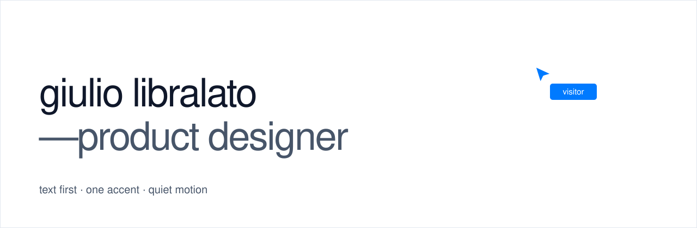

<picture>
  <source media="(prefers-color-scheme: dark)" srcset="assets/readme/cover-dark.svg">
  
</picture>

**→ [preview: giuliolibralato.github.io/portfolio](https://giuliolibralato.github.io/portfolio/)**

personal portfolio · bilingual (en · es) · built text first, with one accent and quiet motion.

## what's here

| | |
|---|---|
| [`PRD.md`](PRD.md) | what the site is: pages, sections, seo |
| [`DESIGN.md`](DESIGN.md) | the design system: tokens, type, 12-column grid, components, motion |
| [`app/`](app/) · [`components/`](components/) | the site in react (next.js) |
| [`design-canvas/`](design-canvas/Main.dc.html) | the home, designed in claude design |
| [`assets/cursors/`](assets/cursors/README.md) | multiplayer-style cursors, svg |
| [`cases/`](cases/) | case studies, one markdown file per language |
| `metricas-*.sql` | queries behind the real usage numbers of personal projects |

## system at a glance

- **type** · geist · 20/28 for names and titles, 15/24 for reading · lowercase titles
- **color** · slate neutrals + one ios blue `#007AFF` (`#0064D2` for text)
- **layout** · side rail + centered content, 880 px on 12 columns, 32 px gutter
- **motion** · under 300 ms for ui, ease-out, gated hover, reduced-motion respected

## stack

react 19 · next.js 15 (static export) · motion · gsap · github pages

motion follows the references: react bits rubber segment (tabs), card swap (gsap), warm tooltip, plus billy sweeney's cover and darina usanova's cascade.

```bash
npm install
npm run dev
```

## status

- [x] plan, design system, home design
- [ ] case studies · beacon (draft), keyway, camino de vida
- [x] home in react, deployed on github pages
- [ ] covers, case pages, seo, custom domain

## confidentiality

client work is shown for portfolio purposes only. all rights belong to designli, konecta and their clients. names, brands, colors and data were changed or removed. private planning notes are not part of this repository.
